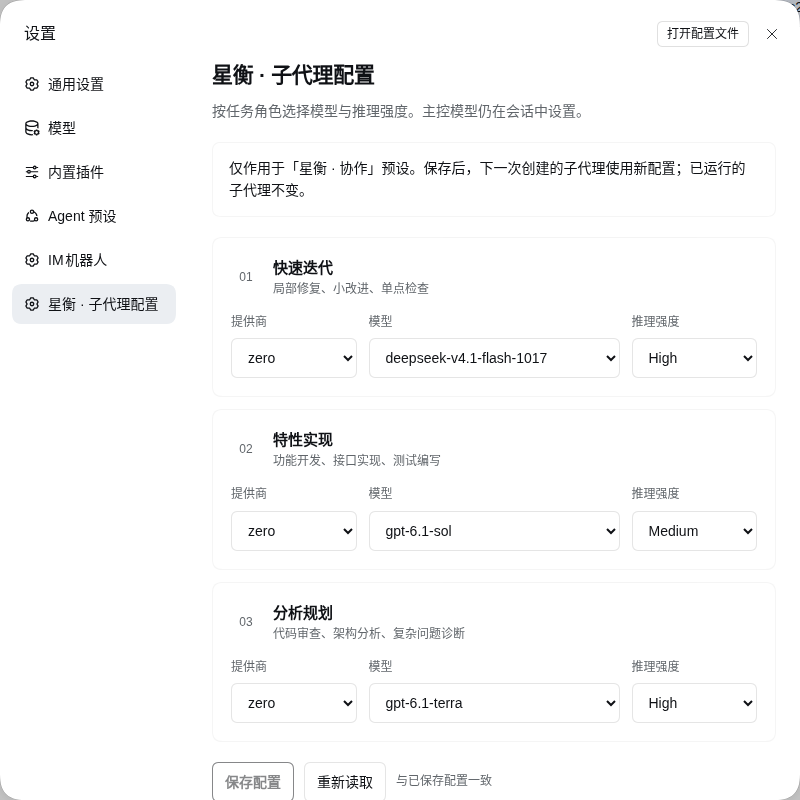

# Xingheng

A DeepSeek Harness (DSH) bundle that splits subagent delegation into three roles: read-only analysis, cohesive implementation and targeted iteration. Each role has its own model. For long-running coordination it uses DSH's native Agent Teams.

**3.1.0** · [中文](README.md) · [Usage](docs/usage.en.md) · [Architecture](docs/architecture.md) · [Migration](docs/migration.md) · [Acceptance](docs/acceptance.md) · [Changelog](CHANGELOG.md)

Source lives in a [private GitHub repository](https://github.com/skybbk1001/dsh-xingheng); access is authorized per account and nothing is published to npm. The declared DSH range is `>=0.2.2-rc.1 <0.3`; actual acceptance and the pinned native executors target **0.2.2-rc.1**, and other versions in that range were not tested one by one. Node.js 22+.

## The three roles

| Role | Key / delegation tool | Preset | What it delivers |
|---|---|---|---|
| Quick iteration | `iterate` / `subagent_iterate` | `xingheng-worker`, read/write and commands | Minimal patch for a known defect or an explicitly authorized check, with the changes and the checks actually run |
| Feature implementation | `implement` / `subagent_implement` | `xingheng-worker`, read/write and commands | A complete, cohesive feature slice with interfaces and tests |
| Analysis and planning | `analyze` / `subagent_analyze` | `xingheng-analyst`, code reading | Exploration, root-cause diagnosis, a design, or a zero-context review, with file and line evidence |

Analysis and execution run on the same native DSH executors. What differs is the mounted preset and the contract given to it. The analyst preset registers no write, edit, shell or job tools; a Host-owned policy then trims the inherited browser, search, IM, configuration and delegation capabilities, and a runtime guard rejects calls outside the allowlist.

## Boundaries

- Tool trimming happens at the DSH tool layer only. **It is not an OS sandbox**: the analyst can still read authorized files and message its parent, and `xingheng-worker` can still make network calls from a shell. File permissions are whatever the DSH sandbox mode says.
- A trusted plugin may register tools closer to the agent that stay visible, but the guard still rejects calls outside the allowlist.
- Write scopes, validation permission, the 12-call / 10-minute checkpoint and the delivery freeze are conventions in the prompt. The plugin has no budget controller, file lock or automatic completion gate.
- Parallel analysis reads one shared working tree with no snapshot isolation. Check versions yourself, or freeze writes first.
- The analyst cannot run tests. Hand verification to an execution role and spell out the exact command.

## Suggested workflow

1. Do small tasks directly. Do not split work just to have more agents.
2. For unfamiliar or cross-module work, have the analyst establish the facts, the open questions and a change plan first.
3. Partition by module cohesion: stabilize shared types and core interfaces sequentially, then parallelize independent modules. Give each task its paths, acceptance criteria and validation permission.
4. After a substantial change, review the frozen revision with a fresh analyst subagent. Give it the requirements, the diff, the constraints and the known risks — not the author's full conversation.
5. Collect results, freeze writes, validate, then hand off. Review passing is not the same as tests passing; name the checks that never ran.

## UI and routing

- Start a session with **星衡 · 协作** (`xingheng`).
- **Settings → Xingheng · Subagent configuration** picks a provider, model and reasoning effort per role.
- **Session header → Agent Teams** shows native members and the shared task board.

Options come from the DSH model catalog. Saving validates all three routes, persists through ConfigEditor and reads the result back; a revision conflict refuses the overwrite. Saved routes apply to the next child only — a running child is never swapped mid-flight.

An empty reasoning effort follows native inheritance: the same model may inherit the Lead's effort, a different model takes the adapter default. It is not `off`. Being listed in the catalog does not guarantee the upstream gateway will serve it. Role names and the starting combination say nothing about model strength or price.



[Dark theme](docs/xingheng-dark.png) · [Native Team panel](docs/xingheng-team.png). These come from a real GUI of an earlier build; version and help text may predate 3.1. The code and the dated acceptance record are authoritative.

## Ordinary children vs. native teams

**Ordinary children** start with a fresh context and use the model configured for their role. The Lead drives them with `subagent_message`, `subagent_list` and `subagent_interrupt`: message and interrupt take a child `agent_id`, list takes only `scope`.

**Native teammates** are created with `spawn_teammate`, optionally with `fresh` or `fork` context, and get a dependency-aware shared task board plus peer messaging. A teammate inherits the Lead's model and preset at creation; the current `spawn_teammate` has no per-teammate model parameter, so the three role routes do not apply to teammates. Team messaging uses the `team_roster`, `team_message` and `team_interrupt` aliases over the native executors, addressed by member `target`. Task updates need the current revision, and assigning a task or clearing its blockers does not wake an `inactive` member — send a message.

The bundle's Profile defaults affect other presets too: default preset `xingheng`, delegation depth 1, 2 activation-capacity slots per tree, native team tools on, model pool retained. Capacity counts live, materializing and some waiting/stopping children. Native teams separately cap at **8 lifetime teammate slots**, failed and inactive members included. User overrides win.

## Install and upgrade

The prerequisites are the shipped `dsh-base`, `dsh-web-app` and `dsh-experimental-agent-team-profile` bundles. This package consumes their services rather than reimplementing teams, the agent loop or storage.

Clone the private repository, then ask the DSH assistant to call the `plugin_manager` tool with `action: install_bundle` and the absolute path as `target`. It is not a shell command, and you should not hand-edit the Profile plugin manifest or run package management inside the Profile.

After installing, read `application`, `warnings` and the activation diagnostics. If it returns `restart-required`, restart the original DSH service, then refresh the GUI and start a new session — refreshing the page is not a restart. Existing agents keep their preset revision. Version 3.1 keeps the 3.0 configuration keys and `/api/xingheng/v3`, so the three routes need no re-entry; analysis, however, can no longer modify files or run commands.

## Development

```sh
npm ci --ignore-scripts
npm run verify
npm run pack:check
```

**23 tests** cover validation and CAS, native delegation and controls, team coexistence, preset switching against the real DSH registry, retained read tools, rejected out-of-scope calls and lifecycle cleanup. Unit results and live-model acceptance are recorded separately in the [acceptance report](docs/acceptance.md); old evidence is never presented as current acceptance.

## When something breaks

- 400: check that all three role keys are present, the model is in the catalog and the effort is supported. 409: re-read the revision and save again.
- The analyst cannot run commands by design. Hand the exact command to an execution role as an explicit authorization.
- A 504 is a gateway timeout; switching roles or retrying will not fix it. Identify the provider, status and layer first, then check the origin and its response time — see [troubleshooting](docs/usage.en.md#model-gateway-timeouts).

The plugin does not touch the Lead model, credentials, filesystem permission mode, search engine or MCP/IM settings.

MIT, original icon included. [Contributing](CONTRIBUTING.md) · [Security](SECURITY.md)