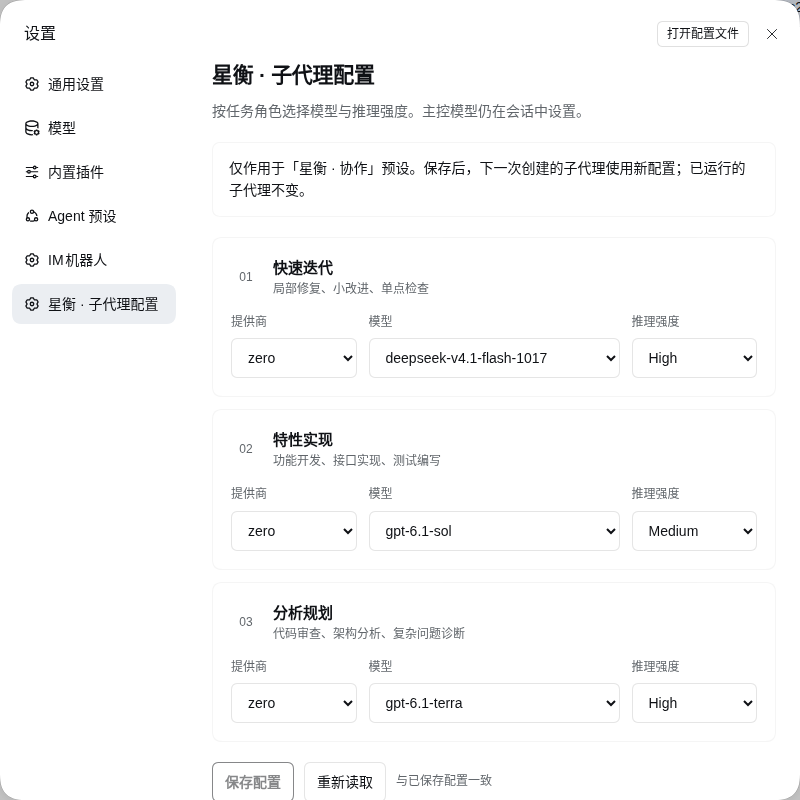
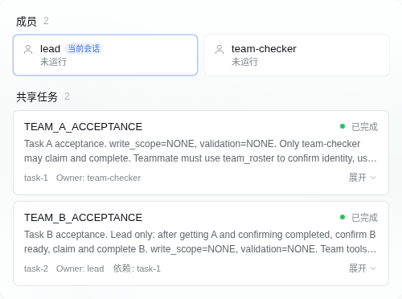

# 星衡（Xingheng）

为 DeepSeek Harness（DSH）提供**按角色持久化配置普通子代理模型与推理强度**，并集成**原生智能体团队（Agent Teams）**与**普通执行单元（Worker）**双轨协作的扩展插件包（Bundle）。

> **版本与分发状态**：当前版本 `2.1.0`，适配 DSH `>=0.2.2-rc.1 <0.3`（当前实测验收基线为 `0.2.2-rc.1`）与 Node.js `>=22`。源码托管于 [GitHub 私有仓库](https://github.com/skybbk1001/dsh-xingheng)，需授权账号访问；未发布到公共 npm 注册表。完整测试与实装边界以 [验收记录](docs/acceptance.md) 为准。

[English Documentation](README.en.md) · [详细使用指南](docs/usage.md) · [English Usage Guide](docs/usage.en.md) · [系统架构](docs/architecture.md) · [迁移与清理](docs/migration.md) · [变更记录](CHANGELOG.md)

---

## 核心定位与非目标

星衡是运行在 DSH Host 与 Web 客户端内的配置与预设组合包，**不是独立聊天应用**：

- **三路普通子任务配置**：在 **设置 → 星衡 · 子代理配置** 中，按 **快速迭代（`fast`）**、**特性实现（`text`）**、**分析规划（`long`）** 三个角色配置提供商（Provider）、模型（Model）与推理强度（Reasoning Effort）。
- **原生智能体团队共存**：启用 DSH 原生 Agent Teams，支持命名队友（`fresh` / `fork` 上下文）、点对点消息、带 CAS（Compare-And-Swap）修订号与依赖关系的共享任务看板、状态变更等待及主控中断。
- **命名空间隔离**：将主控的普通子任务控制工具重命名为 `subagent_message`、`subagent_list`、`subagent_interrupt`（按子会话 `agent_id` 寻址），与原生团队工具（按成员名称 `target` 寻址）严格区分，同时在团队成员作用域内提供 `team_roster`、`team_message`、`team_interrupt` 兼容别名。
- **不改主控与全局凭据**：不修改主控（Lead）会话模型选择器、API 密钥、文件沙箱权限模式、搜索引擎、MCP 或 IM 配置。
- **不作性能或价格承诺**：角色名称与初始组合仅用于工作流分工，**不代表模型能力排名、推理速度或计费高低**；插件不包含任何自动测速、成本估算或静默降级逻辑。

---

## 界面入口与预览

星衡在 DSH Web 界面中涉及两个入口：

1. **配置入口**：打开 **设置（Settings）→ 星衡 · 子代理配置**，管理 `subagent_fast`、`subagent_text`、`subagent_long` 三路普通子代理的持久化模型路由。
2. **团队协作入口**：在使用 **星衡 · 协作**（内部 ID `xingheng`）预设的会话中，点击会话标题栏右上角的 **「智能体团队」** 按钮，查看团队成员列表、运行状态与共享任务看板。

以下截图均来自实际安装后的 DSH Web 界面：

### 设置页（浅色模式）



- 深色模式截图见：[docs/xingheng-dark.png](docs/xingheng-dark.png)

### 原生智能体团队面板



---

## 团队协作与普通子任务的边界

星衡在同一预设（`xingheng`）下同时提供**原生智能体团队（Agent Teams）**与**普通角色子任务（Ordinary Subagents）**。两者的定位、模型来源、寻址协议与容量上限完全不同，切勿混用：

| 维度 | 普通角色子任务（Worker） | 原生智能体团队（Agent Teams） |
| :--- | :--- | :--- |
| **适用场景** | 边界清晰的单点修复、独立功能模块开发、只读审查与诊断 | 需要共享任务看板、前后置依赖协调、多成员点对点通信的复杂协作 |
| **创建工具** | `subagent_fast` / `subagent_text` / `subagent_long` | `spawn_teammate`（仅 Team Lead 可调用） |
| **运行预设** | **星衡 · 执行单元**（`xingheng-worker`） | 继承主控当前预设（`xingheng`） |
| **模型与推理强度** | **由「设置 → 星衡 · 子代理配置」中的三路路由分别控制**；禁止主控在调用参数中临时覆盖模型 | **创建时继承主控（Lead）的模型与预设**；当前 DSH 原生创建接口不提供独立的队友模型参数，设置页三路配置**不控制**队友模型 |
| **上下文模式** | 独立全新子会话（`spawn`），由主控在 `prompt` 中传入完整任务背景 | 默认 `fresh`（全新上下文）；可选 `fork`（继承主控已完成的对话历史） |
| **控制工具与别名** | 主控使用 `subagent_message`、`subagent_list`、`subagent_interrupt`；子代理内部保留原生 `send_message` 等向父级汇报 | 原生 `list_agents`、`send_message`、`interrupt_agent`、`wait_agent`、`team_task_*`，并在成员作用域内同时挂载兼容别名 **`team_roster`**、**`team_message`**、**`team_interrupt`** |
| **寻址标识符** | **`agent_id`**（子会话 ID） | **`target`**（成员名称，如 `'lead'` 或 `'reviewer'`，采用 `lower-kebab-case`） |
| **工具面限制** | 受 `xingheng-worker-policy` 限制，仅开放文件读写/搜索、Shell（`bash`/`pwsh`）、后台作业（`job_*`）、父子通信与 `skill`；**无浏览器、搜索、IM 或再次委派工具** | 具备协作预设工具与团队任务/通信工具；只有 Team Lead 可以创建或中断队友 |

### 并发上限（2）与团队名额（8）的区别

- **活动子代理并发上限（`maxActiveSubagents: 2`）**：由 Profile 级 `subagent` 配置控制，限制每棵 activation 树中在线及正在物化的子级容量为 **2**（不含根主控）；等待、待处理收件箱和停止清理期间也可能占用名额，不能仅按 `running` 行数判断容量，最大委派深度 `maxDepth: 1`（禁止子代理嵌套委派）。
- **团队成员累计名额（默认 8）**：由 DSH 原生智能体团队机制控制，表示单次会话生命周期内可创建的命名队友总槽位数为 **8**。该名额包含不活动（`inactive`）和创建失败（`failed`）的成员，且成员名称在会话内不可复用。
- **注意**：`inactive` 仅表示队友当前没有正在执行的回合（Turn），不代表任务已完成或已销毁；分配共享任务不会自动唤醒 `inactive` 队友，必须使用 `team_message` / `send_message` 发送消息唤醒。

---

## 安装说明

### 环境要求

- **Node.js**：`>=22`
- **Profile 前置组件**：需已启用 DSH 的 `dsh-base`、`dsh-web-app` 与 `dsh-experimental-agent-team-profile` 官方组合包。星衡复用这些包提供的服务，不会在缺少 Team 服务时自行创建另一套实现。
- **DeepSeek Harness (DSH)**：`>=0.2.2-rc.1 <0.3`（当前绑定并实测验证的版本为 `0.2.2-rc.1`）

### 通过助手工具安装（推荐）

在已开启 `danger-full-access` 权限（或允许插件管理审批）的 DSH 会话中，直接向助手发送指令：

> 请调用 `plugin_manager` 工具，使用 `install_bundle` 安装本地目录 `/absolute/path/dsh-xingheng`。

**关键注意事项**：

1. **`plugin_manager` 是 DSH 助手内置工具（Tool Call），不是终端 Shell 命令**。请勿在 `bash` 终端中直接输入 `plugin_manager`。
2. 插件管理器会自动处理 Profile 清单写入与依赖绑定，**请勿手动编辑 DSH Profile 下的运行时插件清单文件**。
3. **检查返回状态**：安装调用返回后，查看结果中的 `application` 字段与 `warnings` 列表：
   - 若返回 `applied`，表示插件已在当前运行中的 Host 生效，刷新浏览器页面即可看到设置项与预设。
   - 若返回 `restart-required`（或提示 `unmanaged-plugin` 等需重载状态），必须**重启原有的 DSH Host 服务进程**，然后再刷新浏览器页面。**单纯刷新浏览器页面不等于重启 DSH 服务进程，启动另一个新的端口服务也不会更新当前正在使用的 GUI。**

---

## 快速上手与配置方式

1. **选择预设**：在 DSH Web 界面新建会话，在预设选择器中选择 **星衡 · 协作**（`xingheng`）。
2. **打开设置**：进入 **设置 → 星衡 · 子代理配置**。
3. **配置三路角色**：
   - **01 快速迭代（`fast`）**：用于局部修复、小改进、单点检查（对应工具 `subagent_fast`）。
   - **02 特性实现（`text`）**：用于功能开发、接口实现、测试编写（对应工具 `subagent_text`）。
   - **03 分析规划（`long`）**：用于代码审查、架构分析、复杂问题诊断（对应工具 `subagent_long`）。
4. **理解推理强度（Effort）**：
   - 下拉框仅展示当前提供商与模型实际声明支持的推理档位。
   - 选择 **「原生默认（同模型可继承主控）」**（配置值为空字符串 `""`）时，保持 DSH 原生委派行为：若子代理与主控模型相同，可继承主控推理强度；若模型不同，则使用模型适配器的默认档位。**空字符串不代表关闭推理（`off`）。**
5. **保存与生效时机**：
   - 点击 **「保存配置」**，后端通过 `validateWorkers` 校验提供商、模型与推理档位是否在当前目录中注册并声明受支持（不保证网关可成功生成）（不发起模型生成请求），并通过 `ConfigEditor` 带 `expectedRevision` 进行双阶段 CAS 原子写入。
   - 保存成功后界面自动回读确认。新配置**从下一次创建普通子代理时生效**；已经启动或正在运行的子代理保持创建时的路由不变。
   - 点击 **「填入初始组合」** 仅填充表单草稿，不会自动保存；若当前目录中不存在初始组合中的模型，必须手动改选有效模型后才能保存。

除 Web 设置页外，星衡还提供共享同一校验与持久化逻辑的 **`xingheng_config` 工具**与 **`/xingheng` 斜杠命令**。完整参数格式、协作工作流与故障排查请参阅 **[详细使用指南](docs/usage.md)**。

---

## Profile 级策略、重启与旧会话边界

清理旧版独立策略包后，`@local/dsh-xingheng` 通过 [`cordis.patch.yml`](cordis.patch.yml) 接管了当前 Profile 的默认策略。**这些配置作用于当前 Profile 下的所有预设，不仅限于星衡预设**：

- **默认预设**：将 `agent-preset-registry` 的 `default` 与 `selectedDefault` 设为 `xingheng`。
- **子代理深度与并发**：将 `subagent` 设为 `maxDepth: 1`、`maxActiveSubagents: 2`。
- **原生团队开关**：将 `tool-agent-team` 设为 `disabled: false`。
- **可选模型池**：保留 `subagent-model-selection-settings` 的 `allowedModels` 列表（`zero/gpt-6-astra`、`zero/deepseek-v4.1-flash-1017`、`zero/gpt-6.1-sol`、`zero/gpt-6.1-terra`）。用户在 DSH 设置中的覆盖层始终优先于 Bundle 默认值。

### 会话 Preset Revision 与历史记录说明

- **旧会话不会原地升级**：运行中的 Agent 保留已挂载的内存预设 revision，日志记录的是预设 ID，并不永久保存旧版实现。进程重启后，恢复会话会按该 ID 解析当前定义；若定义已移除则可能无法恢复。升级时，**不要假定正在运行的旧 Agent 已获得新的预设工具**；请新建 `xingheng` 会话以使用完整的 `2.1.0` 能力。
- **历史日志保留与续跑限制**：卸载旧版预设（如 `economy`）不会删除或篡改历史会话日志文件，用户仍可查阅历史记录；但被移除的旧预设在 Host 重启后无法再次实例化，因此旧预设会话不保证能原样恢复续跑。详见 [迁移与清理说明](docs/migration.md)。

---

## 故障排查摘要

| 现象 | 原因分析 | 处理方法 |
| :--- | :--- | :--- |
| 设置页提示「当前配置中的项目不在目录中」或保存返回 `HTTP 400` | 已保存或草稿中的 `provider`、`model` 或 `effort` 未在当前 DSH `llm` 服务中注册，或模型不支持该推理档位 | 在下拉框中重新选择当前目录内可用的提供商、模型与推理强度后再点击保存 |
| 保存配置返回 `HTTP 409`（`Configuration conflict`） | 另一个页面、工具调用或命令在当前页面读取配置后先行修改了配置，`expectedRevision` 已过期 | 点击 **「重新读取」**（或先调用 `action: "read"` 获取最新 `revision`），重新应用修改后保存 |
| 设置页提示「星衡预设未激活」 | 插件刚安装尚未完全加载，或预设插件在插件管理器中被禁用 | 检查 `plugin_manager` 状态；若安装返回 `restart-required`，重启原 DSH Host 进程后刷新浏览器 |
| 在当前会话中找不到 `spawn_teammate`、`team_message` 或 `subagent_list` | 当前会话创建于升级前（持有旧 Preset Revision），或新建会话时未选择「星衡 · 协作」预设 | 若刚更新插件且要求重启，先重启 DSH Host，然后**新建**一个选择「星衡 · 协作」预设的会话 |
| 模型调用团队通信工具时报错或声称 `list_agents` / `send_message` 不可用 | 验收中模型曾声称原生名称不可调用，虽然请求日志包含这些工具；具体客户端原因尚未确认 | 引导主控或队友优先调用等价的团队兼容别名：**`team_roster`**、**`team_message`**、**`team_interrupt`** |
| `team_task_update` 报错修订号冲突（Stale Revision） | 共享任务看板采用 CAS 并发控制，任务已被其他成员更新 | 先调用 `team_task_get` 或 `team_task_list` 读取最新 `revision`，再传入最新的 `expected_revision` 重试 |
| 分配了共享任务，但队友一直处于 `inactive` 状态不开始工作 | `team_task_update` 更改任务归属或依赖就绪**不会**自动唤醒队友回合 | 调用 `team_message`（或 `send_message`）向该队友的 `target` 名称发送包含具体指令的消息以启动其回合 |

更多排查细节见 [详细使用指南](docs/usage.md)。

---

## 开发与质量门槛

在仓库根目录（`/absolute/path/dsh-xingheng`）运行：

```sh
npm ci --ignore-scripts
npm run verify
npm run pack:check
```

- `npm run check`（[`scripts/check.mjs`](scripts/check.mjs)）：静态检查 `package.json` 必需文件、`src/` 与 `client.js` 语法、`cordis.patch.yml` 结构与无硬编码本地路径、双语元数据（`locale/zh.json`、`locale/en.json`）、原创 SVG 图标，以及客户端不使用 Vue / 私有内部包引用 / 旧版颜色变量。
- `npm test`（`node --test test/*.test.js`）：共 6 个测试文件（16 项用例），覆盖：
  - [`test/config.test.js`](test/config.test.js)：配置解析、未知字段与空白字符拒绝、对模拟 `llm` 目录的能力校验、AbortSignal 取消保护、ConfigEditor 序列化回调内的 CAS 并发冲突拒绝与写失败传递。
  - [`test/host.test.js`](test/host.test.js)：`/api/xingheng/v2`、`xingheng_config` 工具、`/xingheng` 命令共享操作、HTTP 200/400/409/415 状态码及插件卸载时的副作用清理。
  - [`test/delegation.test.js`](test/delegation.test.js)：复用原生 `@deepseek-ai/dsh-tool-subagent` 执行器、按角色动态读取下一子代理路由、异步 preflight 期间配置变更不污染已受理子代理、禁止主控传参覆盖模型（`modelSelection: false`）。
  - [`test/controls.test.js`](test/controls.test.js)：普通子任务控制别名（`subagent_message` / `subagent_list` / `subagent_interrupt`）映射与原生参数/调用者透传。
  - [`test/team-controls.test.js`](test/team-controls.test.js) 与 [`test/native-team.test.js`](test/native-team.test.js)：原生团队工具与 `team_roster` / `team_message` / `team_interrupt` 兼容别名共存、仅对团队成员安装、保持 CAS / Caller / `fresh` 与 `fork` 上下文传递及生命周期销毁。

---

## 实际验证与未验证边界

我们严格区分**自动化单测/Mock 集成测试**与**真实运行环境验收**，不夸大覆盖范围。完整证据见 [验收记录](docs/acceptance.md)：

### 已实际验证

- **静态检查与 16/16 自动化测试**：包括配置 CAS、Host 路由、普通委派执行器、普通控制别名及原生 Agent Teams 兼容别名全部通过。
- **真实插件安装与持久化**：通过 `plugin_manager` 实装到当前 Web Profile，通过真实 Web UI、HTTP API 与 `xingheng_config` 工具完成读取、修改保存、页面刷新回读、400/409 负向拦截，以及独立 `dsh --profile web --dump-config` 磁盘冷组合核对。
- **真实模型调用 — 普通子任务与共存**：在新建 `xingheng` 会话中真实发起 `subagent_fast` 委派与 `subagent_list` 查询，创建 `xingheng-worker` 子代理并完成真实模型响应闭环。
- **真实模型调用 — 原生智能体团队**：在新建 `xingheng` 会话中由 Lead 真实调用 `spawn_teammate`（`fresh` 模式）创建命名队友，验证队友间点对点消息往返、通过 `team_roster` / `team_message` / `team_interrupt` 别名操作、共享任务 `task-1` → `task-2` 依赖解锁与 CAS 认领完成、无活动成员时 `wait_agent` 立即返回 `noProgress`，并在真实 Web GUI 截取原生团队面板截图。

### 尚未验证（已知边界）

- **未逐一对 `text` / `long` 角色及 `fork` 模式发起真实模型计费请求**：`text` / `long` 的路由传递与 `fork` 上下文参数已由原生执行器集成测试核对，真实验收仅对 `fast` 与 `fresh` 发起实际模型调用。
- **完整团队功能流程尚未在重启后全部重跑**：用户已于 13:42 重启服务；后续只读复核确认接口返回 2.1.0、保存配置保留且冷组合无警告。此前团队及普通子任务验收仍属重启前记录，详见验收记录。
- **未验证强制中断正在写文件的队友**：中断测试仅针对 `inactive` 队友验证了原生状态返回（`previousStatus: inactive`），未在验收中制造文件写入中途强行中断的破坏性场景。
- **未覆盖移动设备真机、屏幕阅读器及全部第三方模型网关**。

---

## 仓库目录结构

```text
/absolute/path/dsh-xingheng
├── cordis.patch.yml        # Bundle 注入声明：服务、预设（xingheng / xingheng-worker）与 Profile 级策略
├── package.json            # 包清单、导出路径、DSH 客户端注入与依赖锁定
├── client.js               # Web 客户端设置面板（原生 React + settings.section 插槽）
├── icon.svg                # 原创插件 SVG 图标
├── locale/                 # 插件元数据多语言文件（zh.json / en.json）
├── src/
│   ├── config.js           # 三路配置解析、LLM 目录能力校验与 ConfigEditor 双重 CAS 保存
│   ├── host.js             # Xingheng Host 服务：/api/xingheng/v2、xingheng_config 工具与 /xingheng 命令
│   ├── delegation.js       # 封装原生 @deepseek-ai/dsh-tool-subagent 的按角色动态路由插件
│   ├── controls.js         # 主控普通子任务控制工具重命名（subagent_message / list / interrupt）
│   ├── team-controls.js    # 团队成员作用域的原生控制别名（team_roster / message / interrupt）
│   └── policy.js           # 普通执行单元（xingheng-worker）工具白名单掩码
├── scripts/
│   └── check.mjs           # 清单、语法、便携性与客户端规范静态检查脚本
├── test/                   # Node.js 原生测试套件（6 个测试文件，16 项回归测试）
└── docs/
    ├── usage.md            # 中文详细使用与故障排查指南
    ├── usage.en.md         # 英文详细使用与故障排查指南
    ├── architecture.md     # 架构设计与原生共存机制说明
    ├── migration.md        # 旧版清理、Profile 策略接管与 2.1 升级说明
    ├── acceptance.md       # 真实环境验收记录（历史实测档案）
    └── xingheng-*.png      # 真实 DSH Web 界面截图（浅色、深色、团队面板）
```

---

## 安全与许可

- 本包以 MIT 许可证分发（含原创 `icon.svg`）。
- 参与开发前请阅读 [贡献指南](CONTRIBUTING.md)；安全边界与漏洞报告方式见 [安全策略](SECURITY.md)。
